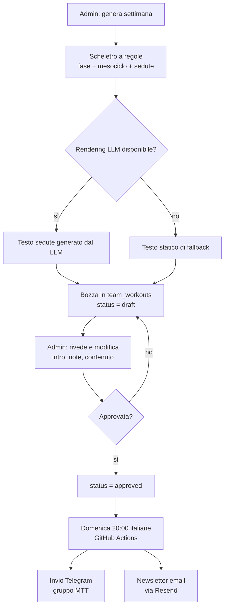

# Allenamenti MTT — come vengono preparati oggi

> Documento richiesto dal gruppo MTT il 09/11/2026 (Achille, Luca Bacci) per chiarire il funzionamento attuale del servizio allenamenti e definire le modifiche da apportare.
> Stato: **aggiornato il 12/11/2026**. La struttura 3 obbligatorie + 2 forza + facoltative e la disciplina `strength` sono implementate (step B); restano aperti memoria dell'archivio nel prompt (step C) e ancoraggio alle gare (step D).

## 1. In sintesi

Gli allenamenti settimanali MTT vengono prodotti da un sistema a due livelli:

1. **Periodizzazione a regole** — uno scheletro deterministico costruito in base al mese e alla settimana del mesociclo.
2. **Rendering LLM** — il testo delle singole sedute viene espanso da un modello linguistico a partire dallo scheletro; se il modello non è disponibile si usa un rendering statico di fallback.

Il piano generato è una **bozza**: non parte nulla verso il gruppo finché un admin non la rivede, la modifica e la approva. L'invio avviene la domenica sera (20:00 italiane) su Telegram, con newsletter email di accompagnamento.

## 2. Flusso completo

Punti chiave del flusso:

- **Nessun invio automatico senza approvazione.** Il workflow domenicale invia solo record in `status = 'approved'`.
- **Revisione admin già disponibile**: tab **Admin → Allenamenti MTT**, con anteprima della settimana e modifica di introduzione e note prima dell'approvazione.
- **Test**: l'admin può inviare una prova a se stesso prima dell'invio al gruppo.
- **Invio**: doppia schedule UTC (18:00 e 19:00) con guardia sul fuso `Europe/Rome`, così l'orario resta 20:00 italiane anche con il cambio ora legale/solare.

## 3. Come nasce lo scheletro (periodizzazione a regole)

### 3.1 Macro-fase stagionale

La fase è decisa **solo dal mese**:

| Periodo | Macro-fase | Etichetta mostrata | Obiettivo |
|---|---|---|---|
| Novembre | `transition` | **Forza e tecnica** | transizione + base aerobica + forza, tecnica nuoto |
| Dicembre – Febbraio | `base` | Base | fondo aerobico, tecnica, adattamento |
| Marzo – Aprile | `build` | Build | soglia, progressione del carico |
| Maggio – Agosto | `peak` | Peak / Gara | ritmo gara, simulazioni |
| Settembre – Ottobre | `transition` | Transizione | mantenimento, recupero |

Novembre usa la macro-fase `transition` (come nel modello storico del club) ma con etichetta e contenuti dedicati: è il mese in cui si costruisce la forza e si riprende la tecnica, non un semplice mantenimento.

### 3.2 Mesociclo di 4 settimane

La settimana dell'anno è calcolata in formato ISO 8601. La posizione nel mesociclo è ciclica:

- settimana 1: avvio, carico contenuto
- settimana 2: progressione, carico medio
- settimana 3: picco del mesociclo, carico massimo
- settimana 4: **scarico**, volume ridotto del ~35%

### 3.3 Struttura settimanale attuale

La settimana segue il modello del club: **3 sedute obbligatorie (1 nuoto, 1 bici, 1 corsa) + 2 sedute di forza + facoltative** sulla disciplina più debole.

In novembre (fase **Forza e tecnica**) la settimana è:

| Giorno | Seduta | Note |
|---|---|---|
| Lunedì | Forza A — corpo libero | squat, affondi, piegamenti, plank, ponti |
| Martedì | Nuoto — tecnica | 2.300–2.500 m con blocchi tecnica/ritmo |
| Mercoledì | Corsa — qualità | 4×2 km medio oppure progressione 8–10 km |
| Giovedì | Nuoto — gruppo in piscina | seduta di gruppo con il coach, 60 minuti |
| Venerdì | Forza + circuito | circuito forza con richiami di corsa |
| Sabato | Bici — fondo Z2 | blocchi di forza in bici |
| Domenica | Corsa — lunga | **facoltativa** (12–16 km Z2 o riposo) |

Da dicembre a febbraio la struttura resta la stessa (2 forza, nuoto tecnica/aerobico, corsa qualità/fondo, bici Z2, due facoltative); in `build` la forza scende a una seduta di mantenimento e compaiono soglia e brick; in `peak` la forza scompare e le sedute diventano specifiche gara.

Ogni seduta ha: **giorno**, titolo, durata, focus, intensità in **RPE** (scala 1–10) e traccia del lavoro principale. Le sedute facoltative sono marcate come tali. Nelle fasi `build` e `peak` alcune bici includono un **brick run**. L'intensità non usa mai valori FTP assoluti: si lavora per RPE finché l'atleta non ha un FTP misurato.

La quarta settimana del mesociclo è scarico: il volume scende del ~35%, la forza riduce i giri ma non sparisce.

### 3.4 Ruolo del LLM

Il modello (oggi Groq, `openai/gpt-oss-120b`, una chiamata a settimana) riceve:

- lo scheletro della settimana (fase, mesociclo, sedute, durate, focus);
- il titolo della settimana precedente, per variare il testo;
- le regole di stile e il formato JSON di output.

Il LLM **non** riceve: l'archivio degli allenamenti passati del club, il livello dei singoli atleti, le gare obiettivo. Espande quindi lo scheletro in modo coerente, ma senza memoria storica del modo di allenarsi del MTT.

Se il LLM non risponde o la risposta non è valida, il sistema usa il rendering statico: il piano resta completo e inviabile, ma con testi più standard.

## 4. Cosa arriva agli atleti

- **Telegram** (gruppo MTT): agenda per giorno (`📅 LUNEDÌ`, `📅 MARTEDÌ`, …) con per ogni seduta riscaldamento / lavoro principale / defaticamento / consigli, la corsa post-bici dove prevista e il marcatore `facoltativo`. Le sedute di forza hanno il loro blocco dedicato.
- **Newsletter email** (Resend, mittente `allenamenti@zetabytenexus.it`): spiegazione della settimana, fase attuale, struttura 3 obbligatorie + 2 forza + facoltative, spiegazione dell'RPE, invito al test FTP (da ripetere ogni 6 settimane), sintesi per disciplina (inclusa la forza) e link al gruppo Telegram.

## 5. Limiti e stato delle critiche del 09/11/2026

Stato al 12/11/2026:

1. **Palestra / corpo libero — risolto (step B).** Esiste la disciplina `strength`, con 2 sedute a settimana in novembre/base e 1 di mantenimento in build.
2. **Struttura diversa da quella del club — risolto (step B).** La settimana è 3 obbligatorie + 2 forza + facoltative sulla disciplina debole.
3. **Novembre non "base + tecnica + forza" — risolto (step B).** Novembre ha etichetta "Forza e tecnica", nuoto in metri con blocchi tecnica (2.300–2.500 m) e due sedute di forza.
4. **Nessuna "memoria" degli allenamenti passati — aperto (step C).** L'archivio storico è ora disponibile e catalogato (`docs/project/allenamenti-archivio/`), ma non è ancora iniettato nel prompt del LLM né nel fallback statico.
5. **Nessun ancoraggio a gare o periodo obiettivo — aperto (step D).** La periodizzazione resta calendariale.
6. **Piano uguale per tutti — aperto.** Le note continuano a dichiararlo: nessuna personalizzazione per livello.
7. **Revisione prima dell'invio — disponibile.** Bozza → modifica → approva → invia, con anteprima e prova a se stessi.

## 6. Modifiche proposte e decisioni aperte

### 6.1 Da decidere con il gruppo

- **Periodo/gare obiettivo**: la preparazione va ancorata a gare concrete o a un periodo (es. "base invernale fino a febbraio, poi build verso le gare di primavera")? Senza questa decisione la periodizzazione resta generica.
- **Conferma struttura**: 3 obbligatorie + 2 forza + facoltative è stata implementata sulla base dei documenti del club; va confermata da Luca.
- **Archivio storico**: la cartella Drive `Allenamenti` è disponibile e catalogata (297 file, 2016–2026). Restano da confermare i 17 file senza anno/mese, i 6 PDF corsa con titolo interno diverso dal nome e la tassonomia "novembre = transizione".

### 6.2 Modifiche tecniche

- **B — fatto (12/11/2026)**: disciplina `strength`, struttura 3+2, nuoto in metri, agenda Telegram per giorno, sezione Forza in newsletter e app, editor admin.
- **C — prossimo**: normalizzare l'archivio (OCR dei 119 file scansionati, in primis il 2026) e iniettarlo nel prompt del LLM e nel fallback statico.
- **D — dopo**: ancoraggio alle gare/periodo e, in prospettiva, priorità alla disciplina più debole.
