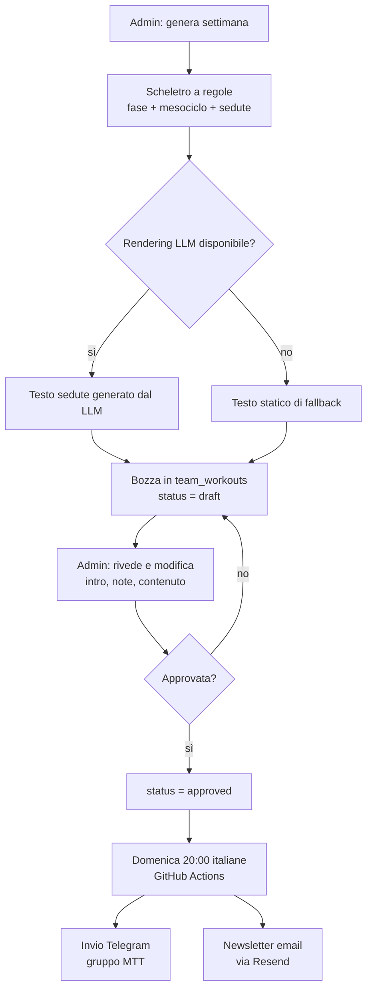

# Allenamenti MTT — come vengono preparati oggi

> Documento richiesto dal gruppo MTT il 09/11/2026 (Achille, Luca Bacci) per chiarire il funzionamento attuale del servizio allenamenti e definire le modifiche da apportare.
> Stato: **descrittivo dell'implementazione attuale** (v6.3.3, novembre 2026). Non contiene ancora le modifiche richieste: quelle sono elencate in fondo come decisioni aperte.

## 1. In sintesi

Gli allenamenti settimanali MTT vengono prodotti da un sistema a due livelli:

1. **Periodizzazione a regole** — uno scheletro deterministico costruito in base al mese e alla settimana del mesociclo.
2. **Rendering LLM** — il testo delle singole sedute viene espanso da un modello linguistico a partire dallo scheletro; se il modello non è disponibile si usa un rendering statico di fallback.

Il piano generato è una **bozza**: non parte nulla verso il gruppo finché un admin non la rivede, la modifica e la approva. L'invio avviene la domenica sera (20:00 italiane) su Telegram, con newsletter email di accompagnamento.

## 2. Flusso completo

Punti chiave del flusso:

- **Nessun invio automatico senza approvazione.** Il workflow domenicale invia solo record in `status = 'approved'`.
- **Revisione admin già disponibile**: tab **Admin → Allenamenti MTT**, con anteprima della settimana e modifica di introduzione e note prima dell'approvazione.
- **Test**: l'admin può inviare una prova a se stesso prima dell'invio al gruppo.
- **Invio**: doppia schedule UTC (18:00 e 19:00) con guardia sul fuso `Europe/Rome`, così l'orario resta 20:00 italiane anche con il cambio ora legale/solare.

## 3. Come nasce lo scheletro (periodizzazione a regole)

### 3.1 Macro-fase stagionale

La fase è decisa **solo dal mese**:

| Periodo | Macro-fase | Obiettivo dichiarato |
|---|---|---|
| Novembre – Febbraio | `base` | fondo aerobico, tecnica, adattamento |
| Marzo – Aprile | `build` | soglia, progressione del carico |
| Maggio – Agosto | `peak` | ritmo gara, simulazioni |
| Settembre – Ottobre | `transition` | mantenimento, recupero |

### 3.2 Mesociclo di 4 settimane

La settimana dell'anno è calcolata in formato ISO 8601. La posizione nel mesociclo è ciclica:

- settimana 1: avvio, carico contenuto
- settimana 2: progressione, carico medio
- settimana 3: picco del mesociclo, carico massimo
- settimana 4: **scarico**, volume ridotto del ~35%

### 3.3 Struttura settimanale attuale

Ogni settimana contiene **6 sedute**, due per disciplina:

- 2 × nuoto
- 2 × bici
- 2 × corsa

Ogni seduta ha: titolo, durata, focus, intensità in **RPE** (percezione dello sforzo, scala 1–10) e una traccia del lavoro principale. Nelle fasi `build` e `peak` alcune sedute bici includono un **brick run** (corsa facile subito dopo la bici). L'intensità non usa mai valori FTP assoluti: si lavora per RPE finché l'atleta non ha un FTP misurato.

### 3.4 Ruolo del LLM

Il modello (oggi Groq, `openai/gpt-oss-120b`, una chiamata a settimana) riceve:

- lo scheletro della settimana (fase, mesociclo, sedute, durate, focus);
- il titolo della settimana precedente, per variare il testo;
- le regole di stile e il formato JSON di output.

Il LLM **non** riceve: l'archivio degli allenamenti passati del club, il livello dei singoli atleti, le gare obiettivo. Espande quindi lo scheletro in modo coerente, ma senza memoria storica del modo di allenarsi del MTT.

Se il LLM non risponde o la risposta non è valida, il sistema usa il rendering statico: il piano resta completo e inviabile, ma con testi più standard.

## 4. Cosa arriva agli atleti

- **Telegram** (gruppo MTT): un messaggio per disciplina/seduta, con struttura riscaldamento / lavoro principale / defaticamento / consigli, e la corsa post-bici dove prevista.
- **Newsletter email** (Resend, mittente `allenamenti@zetabytenexus.it`): spiegazione della settimana, fase attuale, spiegazione dell'RPE, invito al test FTP (da ripetere ogni 6 settimane), sintesi delle sedute e link al gruppo Telegram.

## 5. Limiti attuali (motivo delle critiche del 09/11/2026)

Questi punti sono il divario tra il sistema attuale e le esigenze espresse dal gruppo:

1. **Manca la palestra / il lavoro a corpo libero.** Oggi esistono solo nuoto, bici e corsa. Il riferimento del club prevede invece 2 sessioni di forza/palestra a settimana.
2. **Struttura diversa da quella del club.** Il club indica 3 sedute obbligatorie (1 nuoto, 1 bici, 1 corsa) + 2 palestra, con sedute facoltative sulla disciplina più debole. Noi produciamo 6 sedute, 2 per ogni disciplina, tutte equivalenti.
3. **Novembre non è trattato come "base + tecnica + forza".** La fase è decisa dal mese, ma i contenuti (soprattutto nuoto) non seguono il modello storico del club: volumi in minuti e non in metri, nessun blocco di tecnica strutturato tipo 2300–2500 m.
4. **Nessuna "memoria" degli allenamenti passati.** L'archivio storico non viene usato: il LLM non ha esempi dello stile MTT.
5. **Nessun ancoraggio a gare o periodo obiettivo.** La periodizzazione è generica e calendariale; manca la decisione "per quali gare ci prepariamo".
6. **Piano uguale per tutti.** Le note lo dichiarano esplicitamente: nessuna personalizzazione per livello o disciplina debole.
7. **Revisione prima dell'invio**: già possibile oggi (bozza → modifica → approva), ma va resa esplicita e usata come prassi dal gruppo admin.

## 6. Modifiche proposte e decisioni aperte

### 6.1 Da decidere con il gruppo (prima di toccare il codice)

- **Periodo/gare obiettivo**: la preparazione va ancorata a gare concrete o a un periodo (es. "base invernale fino a febbraio, poi build verso le gare di primavera")? Senza questa decisione la periodizzazione resta generica.
- **Struttura settimanale target**: confermare 3 sedute obbligatorie + 2 palestra + facoltative sulla disciplina debole.
- **Archivio storico**: dove sono e in che formato gli allenamenti degli anni passati (file, documenti, chat)? Servono per costruire la "memoria" del club.

### 6.2 Modifiche tecniche conseguenti

- **B**: aggiungere la disciplina `strength` (palestra/corpo libero) allo scheletro e ristrutturare la settimana secondo il modello del club; aggiornare rendering Telegram, newsletter, tipi dell'app e editor admin.
- **C**: normalizzare l'archivio storico in un riferimento per mese/fase e iniettarlo nel prompt del LLM e nel fallback statico.
- **D**: introdurre l'ancoraggio alle gare/periodo e, in prospettiva, la priorità alla disciplina più debole.

> Nota: questo documento descrive il sistema **così com'è oggi**. Le modifiche B/C/D saranno oggetto di interventi separati e verificabili, dopo le decisioni del punto 6.1.
